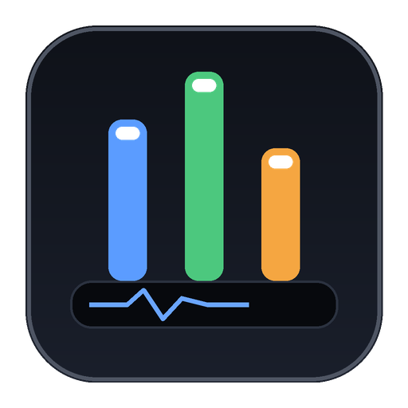
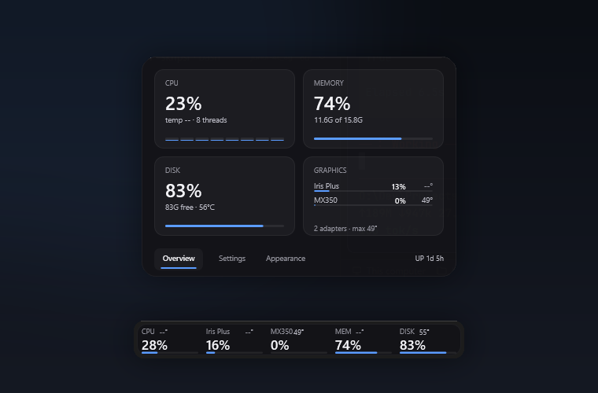
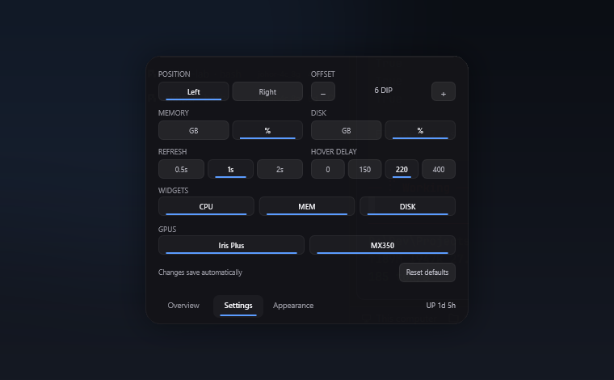

# Taskbar Stats



A lightweight Windows system monitor that lives **inside the taskbar**. It shows
CPU, GPU, memory, and disk activity at a glance, then expands into a detailed
panel on hover.

No installer, no administrator rights, no background service, and no network
access. It uses only user-mode Windows APIs.




## Features

- **Taskbar strip** with one compact cell per metric: CPU, each detected GPU,
  memory, and local disk usage. Each cell shows a live value, secondary
  temperature, and a utilization bar.
- **Hover detail panel** with CPU cores, memory breakdown, disk capacity, and
  per-GPU load and temperature.
- **Three tabs** in the panel: **Overview**, **Settings**, and **Appearance**.
  Tabs stay at the bottom so switching does not move them away from the pointer.
- **Six color themes**: System, Dark, Light, AMOLED, Slate, and Sand.
- **Three independent surface styles**: Solid, Blur (a captured desktop blur
  behind the panel), and Clear (translucent without blur).
- **Per-GPU controls**: each adapter gets its own strip cell and can be shown or
  hidden independently.
- **Smart taskbar placement**: avoids existing taskbar buttons and the
  notification area, snaps into a free gap, and can be dragged into a new spot.
- **Live settings**: position, offset, refresh interval, hover delay, memory and
  disk display modes, widget visibility, per-GPU visibility, themes, styles,
  accent color, and reset. Everything saves automatically.
- **Explorer-restart recovery**, single-instance protection, per-monitor DPI
  support, and a short panel fade that respects the Windows animation setting.
- **Local only**: no analytics, no telemetry, no cloud calls, no drivers, and no
  elevation requirement.

## Screenshots

| Overview | Settings |
| --- | --- |
|  |  |

| Appearance | Taskbar strip |
| --- | --- |
|  |  |

The screenshots use the built-in Dark theme with the Solid surface style.

## Supported systems

| Platform | Status |
| --- | --- |
| Windows 11 x64 | Supported and tested |
| Windows 10 x64, build 19041 or newer | Expected to work; less thoroughly tested |
| Windows on ARM | Not supported |
| Linux / macOS | Not supported |
| Windows Server | Not targeted |

The app targets the **horizontal primary taskbar**. Vertical taskbars,
secondary-monitor taskbars, and heavily customized Explorer replacements have
not been verified.

## Install

### Prebuilt release

1. Open the [latest release](../../releases/latest).
2. Download `TaskbarStats-<version>-windows-x64.zip`.
3. Extract the zip anywhere you want to keep the app.
4. Run `taskbar-stats.exe`.

The strip appears in a free area of the taskbar. There is no installer and
nothing is written to Program Files.

> The executable is not code-signed yet, so Windows SmartScreen may warn. Use
> **More info → Run anyway** after verifying you downloaded it from this
> repository's Releases page.

### Start with Windows (optional)

1. Press `Win + R`, type `shell:startup`, and press Enter.
2. Create a shortcut to `taskbar-stats.exe` in the Startup folder.

The app also reattaches itself after Explorer restarts.

### Uninstall

1. Right-click the strip and choose **Exit**.
2. Delete the extracted app folder.
3. Optionally remove `%APPDATA%\TaskbarStats` to delete the config and log.

## Usage

- **Hover** the strip to open the detail panel.
- Move away to close an unpinned panel automatically.
- **Click** the strip to toggle a pinned panel. **Middle-click** opens Settings
  directly.
- **Drag** the strip horizontally to reposition it. On release, it snaps into
  the nearest free taskbar gap.
- **Right-click** the strip for Settings, Reload config, and Exit.
- Clicking non-button panel space does not pin a hover-opened panel.
- Empty panel space on a pinned panel closes it.

### Settings tab

The Settings tab controls placement and behavior:

- left/right anchor and offset
- memory and disk display mode (`GB` or `%`)
- refresh interval (0.5 s, 1 s, 2 s)
- hover delay (0, 150, 220, 400 ms)
- visible widgets and per-GPU visibility
- reset to defaults

### Appearance tab

The Appearance tab controls only visual choices:

- theme: System, Dark, Light, AMOLED, Slate, Sand
- surface style: Solid, Blur, Clear
- accent color: six presets

Theme and style are independent, so combinations such as **Light + Blur**,
**Dark + Blur**, and **Dark + Solid** all work.

## Configuration

Settings are managed from the panel and saved automatically. The file is also
available for manual inspection or migration:

```text
%APPDATA%\TaskbarStats\config.toml
```

Default shape:

```toml
position = "right"
offset = 6
widgets = ["cpu", "gpu", "mem", "disk"]
theme = "system"
style = "solid"
accent = "#5B9CFF"
hover_delay_ms = 220
update_ms = 1000
mem_mode = "gb"
disk_mode = "gb"
gpu_visible = []
```

| Key | Meaning |
| --- | --- |
| `position` | `"left"` or `"right"`. Desired side of the taskbar. |
| `offset` | Desired edge gap in DIPs. Collision avoidance may move the strip farther inward. |
| `widgets` | Ordered list: `cpu`, `gpu`, `mem`, `disk`; legacy `temp`/`gputemp` cells are migrated. |
| `theme` | `system`, `dark`, `light`, `amoled`, `slate`, or `sand`. |
| `style` | `solid`, `blur`, or `clear`. |
| `accent` | Six-digit hex color for progress fills and selected controls. |
| `hover_delay_ms` | Delay before the hover panel appears, 0–2000 ms. |
| `update_ms` | Sampling interval, clamped to 250–5000 ms. |
| `mem_mode` / `disk_mode` | `"gb"` or `"percent"`. The strip value follows the mode; the bar always shows the percentage. |
| `gpu_visible` | Adapter names to show. Empty means all detected adapters. Managed by the Settings tab. |

The legacy `theme = "glass"` value migrates to `theme = "system"` and
`style = "blur"`. Use **Reload config** after editing the file manually; the
Settings and Appearance tabs are the normal path.

## Build from source

### Requirements

- Windows 10/11 x64
- Rust stable with the `x86_64-pc-windows-msvc` target
- Visual Studio Build Tools with the **Desktop development with C++** workload
- Windows 10/11 SDK

### Build

Download or clone this repository, open a terminal in the project folder, and
run:

```bat
scripts\build.bat --release
```

If your terminal already has the Visual Studio and Windows SDK environment:

```bat
cargo build --release
```

The executable is written to:

```text
target\release\taskbar-stats.exe
```

The repository build script uses `vswhere` and falls back to the BuildTools
installation. If the local `.toolchain` directory exists, its SDK import
libraries and build tools are used automatically.

The app icon is compiled from `taskbar-stats.rc` + `assets/icon.ico` by
`build.rs`; no resource compiler needs to be installed separately when the
Windows SDK is available.

### Checks

```bat
cargo fmt -- --check
cargo clippy --all-targets -- -D warnings
cargo test --all-targets
cargo build --release
```

## Sensors and limitations

- **CPU utilization** comes from system-wide kernel/user/idle counters, with
  per-core counters for the detail panel.
- **CPU temperature** has no standard user-mode Windows API. It requires an ACPI
  thermal zone or vendor driver exposed by the firmware. Many laptops, including
  some Lenovo models, do not expose one to normal applications; the UI shows
  `--` instead of inventing a value.
- **GPUs** are enumerated with DXGI. Utilization uses the Windows GPU Engine
  performance counters; NVIDIA adapters additionally use NVML for utilization
  and temperature. Unsupported adapters show `--`.
- **Disk temperature** uses the standard storage temperature property where the
  drive exposes it; no administrator rights are required on tested NVMe
  hardware.
- **Memory temperature** is unavailable because Windows exposes no standard
  memory temperature API.
- **Disk capacity** sums local fixed NTFS/ReFS volumes with physical extents, so
  cloud-drive letters reported as fixed volumes are excluded.
- **Blur** captures and blurs the desktop behind the panel when it is shown.
  Native acrylic/DWM blur is not used because it does not composite reliably on
  a layered popup.
- **No signing yet**: release executables are unsigned and may trigger
  SmartScreen.
- **No auto-update**: download a newer release and replace the executable.
- **No installer**: configuration lives in `%APPDATA%\TaskbarStats`.
- **Mouse-first UI**: there is no keyboard focus model or screen-reader
  representation yet.

## Privacy

Taskbar Stats does not make network requests, collect analytics, or send data
anywhere. The only files it writes are:

```text
%APPDATA%\TaskbarStats\config.toml
%APPDATA%\TaskbarStats\taskbar-stats.log
```

Both stay on the local machine. The app does not install a service or kernel
driver and does not request administrator rights.

## Troubleshooting

**The strip does not appear**

Check the log at `%APPDATA%\TaskbarStats\taskbar-stats.log`. Restart Explorer or
the app if the taskbar was rebuilt. Only one instance can run per user session.

**The panel closes unexpectedly**

The panel is hover-managed unless you click the strip to pin it. Clicking
non-button panel space no longer pins a hover-opened panel; leave the panel to
close it.

**CPU temperature shows `--`**

The firmware does not expose a thermal zone or sensor to normal applications.
See [Sensors and limitations](#sensors-and-limitations). A kernel driver or
vendor service would be required; the app deliberately does not install one.

**A GPU is missing or shows `--`**

Check that the adapter is enabled in **Settings → GPUs**. Some drivers do not
expose utilization or temperature counters. Switching between integrated and
discrete GPUs can take a few seconds.

**SmartScreen blocks the app**

The executable is unsigned. Verify the release source and choose **More info →
Run anyway**, or build it yourself.

**The strip overlaps another taskbar widget**

Move it with drag, change the offset in Settings, or choose the other side.
Placement scans for free gaps but cannot guarantee space when the taskbar is
full.

## Releases and CI

- **CI** runs on pull requests and manual dispatch. It checks formatting,
  clippy, tests, and a locked release build on `windows-latest`.
- **Release** runs when a tag such as `v0.1.0` is pushed. It verifies that the
  tag matches `Cargo.toml`, builds the executable, packages
  `TaskbarStats-<version>-windows-x64.zip`, and publishes the zip, raw exe, and
  SHA-256 checksum to the GitHub Release.
- There are no signing secrets required. The published executable is unsigned.

See [docs/RELEASING.md](docs/RELEASING.md) for the versioning and tagging steps.

## Development

- [DESIGN.md](DESIGN.md) — visual system, layout tokens, themes, and styles
- [ARCHITECTURE.md](ARCHITECTURE.md) — window model, taskbar placement,
  rendering, timers, and data flow
- [AGENTS.md](AGENTS.md) — repository invariants and verification checklist

Taskbar Stats is an independent project and is not affiliated with Microsoft.
