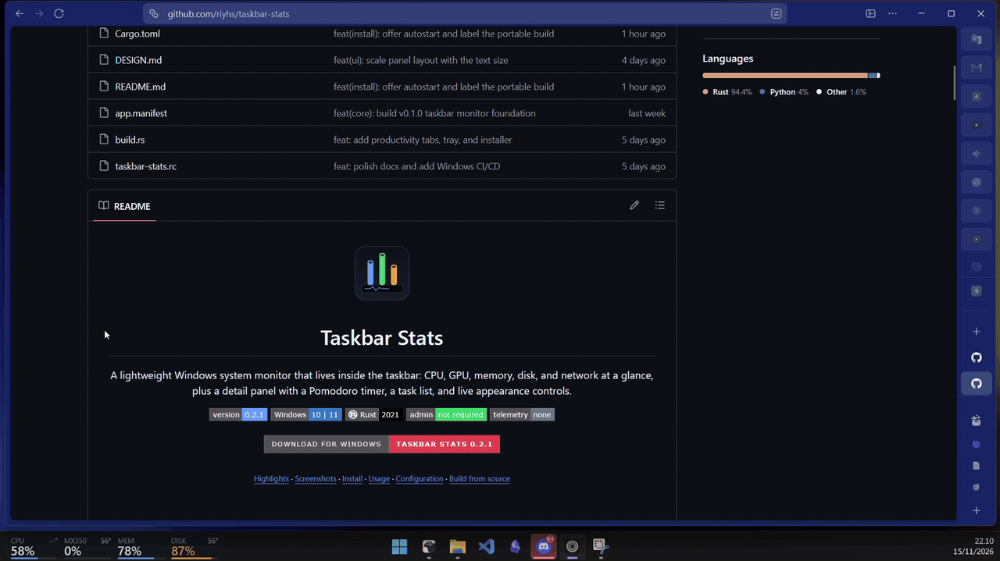

<p align="center">
  
</p>

<h1 align="center">Taskbar Stats</h1>

<p align="center">A lightweight Windows system monitor that lives inside the taskbar: CPU, GPU, memory, disk, and network at a glance, plus a detail panel with a Pomodoro timer, a task list, and live appearance controls.</p>

<p align="center">
  <a href="../../releases/latest"></a>
  
  
  
  
</p>

<p align="center">
  <a href="../../releases/latest"></a>
</p>

<p align="center">
  <sub><a href="#-highlights">Highlights</a> · <a href="#-screenshots">Screenshots</a> · <a href="#install">Install</a> · <a href="#usage">Usage</a> · <a href="#configuration">Configuration</a> · <a href="#build-from-source">Build from source</a></sub>
</p>

<br>

<p align="center">
  
</p>

## ✨ Highlights

- Lives inside the taskbar, not in a floating window
- CPU, GPU, memory, disk, and network in one compact strip
- Detail panel with Overview, Pomodoro, Todo, Settings, and Appearance
- Pomodoro timer with focus and break presets and tray notifications
- Todo list saved with the rest of your configuration
- Six themes and three independent surface styles
- Text size that scales the whole panel, never clipping a label
- Per-GPU cells with individual toggles
- Display picker, so the strip can follow a secondary monitor
- Collision-aware placement that avoids other taskbar buttons
- Drag the strip to any free taskbar gap
- Tray icon and a Start with Windows toggle
- Per-monitor DPI, Explorer-restart recovery, single instance
- Per-user installer and uninstaller, no elevation
- Local only: no telemetry, no drivers, no network access

## 🖼 Screenshots

<table>
<tr>
<td width="50%"><p align="center"><b>Overview</b></p></td>
<td width="50%"><p align="center"><b>Pomodoro</b></p></td>
</tr>
<tr>
<td width="50%"><p align="center"><b>Todo</b></p></td>
<td width="50%"><p align="center"><b>Settings</b></p></td>
</tr>
<tr>
<td width="50%"><p align="center"><b>Appearance</b></p></td>
<td width="50%"><p align="center"><b>Taskbar strip</b></p></td>
</tr>
</table>

The screenshots use the built-in Dark theme with the Solid surface style.

## Supported systems

| Platform | Status |
| --- | --- |
| Windows 11 x64 | Supported and tested |
| Windows 10 x64, build 19041 or newer | Expected to work; less thoroughly tested |
| Windows on ARM | Not supported |
| Linux / macOS | Not supported |
| Windows Server | Not targeted |

The app targets **horizontal taskbars** and follows whichever display you pick
in Settings, including `Shell_SecondaryTrayWnd` on secondary monitors. Vertical
taskbars and heavily customized Explorer replacements have not been verified.

## Install

Two builds are published for every release. They run the same program; only the
packaging differs.

| Download | What it is |
| --- | --- |
| `TaskbarStats-<version>-windows-x64-setup.exe` | Installer. Per-user install, Start menu shortcut, uninstaller. **Recommended.** |
| `TaskbarStats-<version>-windows-x64-portable.exe` | The bare executable. No install, no uninstaller, no shortcuts. |
| `TaskbarStats-<version>-windows-x64.zip` | The same portable executable in a zip, for convenience. |

### Installer (recommended)

1. Open the [latest release](../../releases/latest).
2. Download `TaskbarStats-<version>-windows-x64-setup.exe`.
3. Run it. It installs for the current user under
   `%LOCALAPPDATA%\Programs\TaskbarStats`, adds a Start menu shortcut, and
   creates an uninstall entry.
4. Leave **Start Taskbar Stats with Windows** ticked if you want the widget
   available after every sign-in, then finish the wizard.
5. Launch **Taskbar Stats** from the Start menu or the finish page.

The installer is not code-signed yet, so Windows SmartScreen may warn. Use
**More info → Run anyway** after verifying the download came from this
repository's Releases page.

To uninstall, open **Settings → Apps → Installed apps → Taskbar Stats →
Uninstall**, or use **Start menu → Uninstall Taskbar Stats**. The uninstaller
stops the app, removes its startup registration, shortcuts, and program files.
Your configuration in `%APPDATA%\TaskbarStats` is kept unless you delete it.

### Portable executable

1. Open the [latest release](../../releases/latest).
2. Download `TaskbarStats-<version>-windows-x64-portable.exe`, or the
   `-windows-x64.zip` and extract it.
3. Put it wherever you like and run it.

Nothing is installed and no uninstaller is created. Delete the file when you no
longer need it. Skip the portable build if you want Start with Windows to keep
working after you move the file: the Run key stores an absolute path, so the
toggle has to be turned off and on again after a move. The installer pins the
path for you.

### Start with Windows

The **Start with Windows** chip in the **Settings** tab writes a per-user entry
under `HKCU\Software\Microsoft\Windows\CurrentVersion\Run` and points it at
the running executable. Turning the chip off removes the entry.

The installer writes the same entry when its startup task is left ticked, and the
app adopts it on first launch, so both paths leave the toggle in the right state.

### Tray icon

While Taskbar Stats is running, its icon is added to the notification area. It
may be in the overflow menu (`^`) by default; drag it onto the taskbar if you
want it always visible. Left-click opens the panel; right-click opens the menu.

## Usage

- **Hover** the strip to open the detail panel.
- Move away to close an unpinned panel automatically.
- **Click** the strip to toggle a pinned panel. **Middle-click** opens Settings
  directly.
- **Drag** the strip horizontally to reposition it. On release, it snaps into
  the nearest free taskbar gap.
- **Right-click** the strip for Settings, Reload config, and Exit.
- Clicking non-button panel space does not pin a hover-opened panel.
- Empty panel space on a pinned panel closes it.
- Click a bottom tab to switch panels. The window keeps its bottom edge anchored
  and reuses the current blurred backdrop, so tab changes do not flash or jump.

### Overview

Shows CPU load and temperature, memory use, disk use and temperature, per-GPU
load and temperature, and current network throughput. If a sensor is unavailable,
it shows `--` or `--°` instead of inventing a value.

### Pomodoro

The timer starts at 25 minutes of focus and 5 minutes of break. Use the chips to
choose 25/50 minute focus and 5/10 minute break lengths. **Start/Pause** controls
the countdown; **Reset** returns to a fresh focus session; **Skip** moves to the
other phase without counting a completed session.

When focus ends, the break starts automatically and a tray notification appears.
When the break ends, the timer returns to focus and pauses so you can start the
next session. The timer continues while the panel is closed.

### Todo

Use **Add task** to open a themed text dialog that matches the active theme. Click the checkbox to mark a task
done, `×` to delete it, or **Clear completed** to remove finished items. Tasks
are saved immediately. Up to 20 tasks are kept; five are shown per page.

### Settings

The Settings tab controls placement and behavior:

- left/right anchor and offset
- display to place the widget on (`Auto` or a numbered monitor)
- memory and disk display mode (`GB` or `%`)
- refresh interval (0.5 s, 1 s, 2 s)
- hover delay (0, 150, 220, 400 ms)
- visible widgets (`CPU`, `MEM`, `DISK`, `NET`) and per-GPU visibility
- start with Windows
- reset to defaults

### Appearance

- theme: System, Dark, Light, AMOLED, Slate, Sand
- style: Solid, Blur, Clear
- accent color
- text size: Compact, Normal, Large

## Configuration

The app writes `%APPDATA%\TaskbarStats\config.toml` and
`%APPDATA%\TaskbarStats\taskbar-stats.log`. The supported configuration path is
the Settings and Appearance tabs; the file is shown here for reference.

| Key | Meaning |
| --- | --- |
| `position` | `"left"` or `"right"` |
| `monitor` | `0` follows the primary taskbar; `1..n` is a display number |
| `offset` | Distance from the anchored edge, in DIP |
| `widgets` | Visible strip cells: `cpu`, `gpu`, `mem`, `disk`, `net` |
| `theme` | `system`, `dark`, `light`, `amoled`, `slate`, `sand` |
| `style` | `solid`, `blur`, `clear` |
| `accent` | `#RRGGBB` accent color |
| `hover_delay_ms` | Delay before the panel opens |
| `update_ms` | Sampling interval in milliseconds |
| `mem_mode` | `gb` or `percent` |
| `disk_mode` | `gb` or `percent` |
| `gpu_visible` | Adapter names to show; empty means all detected adapters |
| `font_scale` | Text scale, normally `0.9`, `1.0`, or `1.15` |
| `launch_at_startup` | Mirror of the Start with Windows toggle |
| `pomodoro_focus_min` | Focus duration in minutes |
| `pomodoro_break_min` | Break duration in minutes |
| `todos` | Array of `{ text, done }` task entries |

Changing the file is supported for troubleshooting, but the tabs are the
intended path. Use **Reload config** from the strip or tray menu after an
external edit.

## Build from source

### Requirements

- Rust stable with the `x86_64-pc-windows-msvc` target
- Visual Studio Build Tools with the **Desktop development with C++** workload
- Windows 10/11 SDK

### Build

Download or clone this repository, open a terminal in the project folder, and
run:

```bat
scripts\build.bat --release
```

If your terminal already has the Visual Studio and Windows SDK environment:

```bat
cargo build --release
```

The local executable is written to `target\release\taskbar-stats.exe`. The icon
resource is compiled from `taskbar-stats.rc` and `assets/icon.ico` by `build.rs`;
the Windows SDK `rc.exe` must be available.

### Installer

Install [Inno Setup 6](https://jrsoftware.org/isinfo.php), build the release
executable, then run:

```powershell
.\scripts\build-installer.ps1 -Version 0.2.1
```

The setup executable is written to `dist\TaskbarStats-<version>-windows-x64-setup.exe`.
Inno Setup generates the uninstaller automatically.

### Checks

```bat
cargo fmt -- --check
cargo clippy --all-targets -- -D warnings
cargo test --all-targets
```

## Sensors and limitations

- **CPU temperature** depends on a firmware/ACPI thermal zone. Many Intel
  laptops, including some Lenovo models, do not expose one to user-mode apps;
  the app then shows `temp --` rather than a fabricated value.
- **GPU temperature** is read through NVML when available, with DXGI/D3DKMT
  fallbacks for load. Integrated GPUs may report load but not temperature.
- **Disk temperature** is read from the physical storage device through storage
  IOCTLs and may require the device to expose a temperature sensor.
- **Network speed** is sampled from Windows `Network Interface` performance
  counters. It is a system-wide estimate and may include virtual adapters.
- **Memory has no temperature reading**; temperature is only shown for devices
  that expose one.
- **CPU core bars are intentionally absent** from the Overview. Per-core load was
  too small to read at panel scale; the CPU card shows overall load, temperature,
  and thread count instead.
- The app targets horizontal taskbars on the primary or any secondary monitor.
  Vertical taskbars are not supported yet.
- The executable is currently unsigned. Builds are reproducible from source, and
  release artifacts include SHA-256 checksums.

## Privacy

Taskbar Stats runs locally. It does not send telemetry, make HTTP requests, or
create a network listener. The only writable locations are
`%APPDATA%\TaskbarStats` and, when enabled, the current user's Run registry key.

## Troubleshooting

| Symptom | What to try |
| --- | --- |
| Strip is not visible | Right-click the taskbar and make sure it is not auto-hidden; restart Explorer or the app. |
| Tray icon is missing | Open the notification-area overflow (`^`); Windows may hide new icons by default. |
| Start with Windows did not work | Toggle it off and on after moving the executable; check `HKCU\Software\Microsoft\Windows\CurrentVersion\Run`. |
| Panel is positioned oddly | Drag the strip to a free taskbar gap, or reset the offset in Settings. |
| CPU temperature shows `--` | The firmware does not expose a thermal zone to user-mode apps. This is expected on some laptops. |
| Settings were from an older version | Use **Reset defaults** in Settings; legacy `glass` configs and the old `cpu/temp/mem/disk` widget list migrate automatically. |

Runtime log: `%APPDATA%\TaskbarStats\taskbar-stats.log`

## Releases and CI

- `.github/workflows/ci.yml` runs formatting, clippy with warnings denied, tests,
  and a locked release build on pull requests and manual dispatches.
- `.github/workflows/release.yml` runs on `v*` tags, verifies the tag matches
  `Cargo.toml`, builds the executable and installer, and publishes a release
  titled with the tag. Release notes are generated from the conventional commits
  since the previous tag, grouped into Added, Changed, Fixed, and Removed, with
  `#` issue references, contributor thanks, and a commit link on every bullet.
  Set a `RELEASE_TOKEN` secret to publish releases under a real account instead
  of `github-actions[bot]`. Artifacts:
  - `TaskbarStats-<version>-windows-x64.zip`
  - `TaskbarStats-<version>-windows-x64-portable.exe`
  - `TaskbarStats-<version>-windows-x64-setup.exe`
  - `TaskbarStats-<version>-windows-x64.sha256`
- `.github/workflows/prepare-release.yml` bumps the version and pushes the tag.
  It runs automatically when the merged commit carries a `Release-As: 0.2.1`
  footer, and on demand for everything else. It needs the `RELEASE_TOKEN` secret.

See [docs/RELEASING.md](docs/RELEASING.md) for the release checklist.

## More documentation

- [DESIGN.md](DESIGN.md) — tokens, layout, and visual rules
- [ARCHITECTURE.md](ARCHITECTURE.md) — windowing, sampling, and build layout
- [AGENTS.md](AGENTS.md) — contributor and verification guide
