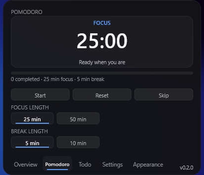
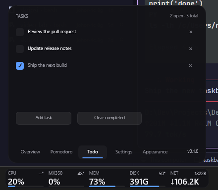
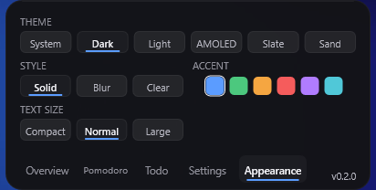
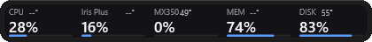

# Taskbar Stats


A lightweight Windows system monitor that lives **inside the taskbar**. It shows
CPU, GPU, memory, disk, and network activity at a glance, then opens a detail
panel with a Pomodoro timer, a small task list, and live appearance controls.

No administrator rights, no background service, and no network access. It uses
only user-mode Windows APIs.


## Features

- **Taskbar strip** with compact cells for CPU, each detected GPU, memory, local
  disk usage, and download/upload speed. Every cell has a live value and a
  utilization or activity bar; temperatures appear where the sensor is available.
- **Five panel tabs**: **Overview**, **Pomodoro**, **Todo**, **Settings**, and
  **Appearance**. The tab bar is anchored to the bottom so it never moves out
  from under the pointer.
- **Pomodoro timer** with 25/50 minute focus presets, 5/10 minute breaks,
  start/pause, reset, skip, completed-session count, progress bar, and Windows
  tray notifications when a phase ends.
- **Todo list** with add, complete, delete, clear-completed, and paging for more
  than five tasks. Tasks are saved with the rest of the configuration.
- **Six color themes**: System, Dark, Light, AMOLED, Slate, and Sand.
- **Three independent surface styles**: Solid, Blur (a captured desktop blur
  behind the panel), and Clear (translucent without blur).
- **Text size control**: Compact, Normal, or Large. Panel geometry, tabs, and
  controls scale with the text, long labels shrink or ellipsize instead of
  overflowing, and the strip follows the setting up to its fixed taskbar
  height.
- **Per-GPU controls**: each adapter gets its own strip cell and can be shown or
  hidden independently.
- **Network speed**: download and upload rates from Windows performance counters,
  available as an optional `NET` strip cell and in a dedicated `NETWORK` row
  under the Overview cards.
- **Smart taskbar placement**: avoids existing taskbar buttons and the
  notification area, snaps into a free gap, and can be dragged into a new spot.
- **Tray icon** while the app is running. Left-click it to open the panel;
  right-click for Settings, Reload config, and Exit.
- **Start with Windows** toggle in Settings. It registers the current executable
  in the current user's Run key; no elevation is required.
- **Live settings**: position, offset, refresh interval, hover delay, memory and
  disk display modes, widget visibility, per-GPU visibility, text size, startup,
  themes, styles, accent color, Pomodoro lengths, and reset. Everything saves
  automatically.
- **Current version in the panel footer**, taken from the release tag in CI and
  from the package version for local builds.
- **Explorer-restart recovery**, single-instance protection, per-monitor DPI
  support, and a short panel fade that respects the Windows animation setting.
- **Installer and uninstaller** in the release artifacts, with a portable zip
  alternative. Both are per-user and do not require elevation.
- **Local only**: no analytics, no telemetry, no cloud calls, no drivers, and no
  elevation requirement.

## Screenshots

| Overview | Pomodoro |
| --- | --- |
|  |  |

| Todo | Settings |
| --- | --- |
|  |  |

| Appearance | Taskbar strip |
| --- | --- |
|  |  |

The screenshots use the built-in Dark theme with the Solid surface style.

## Supported systems

| Platform | Status |
| --- | --- |
| Windows 11 x64 | Supported and tested |
| Windows 10 x64, build 19041 or newer | Expected to work; less thoroughly tested |
| Windows on ARM | Not supported |
| Linux / macOS | Not supported |
| Windows Server | Not targeted |

The app targets the **horizontal primary taskbar**. Vertical taskbars,
secondary-monitor taskbars, and heavily customized Explorer replacements have
not been verified.

## Install

### Installer (recommended)

1. Open the [latest release](../../releases/latest).
2. Download `TaskbarStats-<version>-windows-x64-setup.exe`.
3. Run the installer. It installs for the current user under
   `%LOCALAPPDATA%\Programs\TaskbarStats`, adds a Start menu shortcut, and creates
   an uninstall entry.
4. Launch **Taskbar Stats** from the Start menu or the finish page.

The installer is not code-signed yet, so Windows SmartScreen may warn. Use
**More info → Run anyway** after verifying the download came from this
repository's Releases page.

To uninstall, open **Settings → Apps → Installed apps → Taskbar Stats →
Uninstall**, or use **Start menu → Uninstall Taskbar Stats**. The uninstaller
stops the app, removes its startup registration, shortcuts, and program files.
Your configuration in `%APPDATA%\TaskbarStats` is kept unless you delete it.

### Portable zip

1. Open the [latest release](../../releases/latest).
2. Download `TaskbarStats-<version>-windows-x64.zip`.
3. Extract the zip anywhere you want to keep the app.
4. Run `taskbar-stats.exe`.

The portable build has no installer. Delete the extracted folder when you no
longer need it.

### Start with Windows

Turn on **Start with Windows** in the **Settings** tab. This writes a per-user
entry under `HKCU\Software\Microsoft\Windows\CurrentVersion\Run` and points it at
the running executable. Turn the chip off again to remove the entry.

If you move a portable copy of the app, turn the toggle off and on again so the
registry points at the new location.

### Tray icon

While Taskbar Stats is running, its icon is added to the notification area. It
may be in the overflow menu (`^`) by default; drag it onto the taskbar if you
want it always visible. Left-click opens the panel; right-click opens the menu.

## Usage

- **Hover** the strip to open the detail panel.
- Move away to close an unpinned panel automatically.
- **Click** the strip to toggle a pinned panel. **Middle-click** opens Settings
  directly.
- **Drag** the strip horizontally to reposition it. On release, it snaps into
  the nearest free taskbar gap.
- **Right-click** the strip for Settings, Reload config, and Exit.
- Clicking non-button panel space does not pin a hover-opened panel.
- Empty panel space on a pinned panel closes it.
- Click a bottom tab to switch panels. The window keeps its bottom edge anchored
  and reuses the current blurred backdrop, so tab changes do not flash or jump.

### Overview

Shows CPU load and temperature, memory use, disk use and temperature, per-GPU
load and temperature, and current network throughput. If a sensor is unavailable,
it shows `--` or `--°` instead of inventing a value.

### Pomodoro

The timer starts at 25 minutes of focus and 5 minutes of break. Use the chips to
choose 25/50 minute focus and 5/10 minute break lengths. **Start/Pause** controls
the countdown; **Reset** returns to a fresh focus session; **Skip** moves to the
other phase without counting a completed session.

When focus ends, the break starts automatically and a tray notification appears.
When the break ends, the timer returns to focus and pauses so you can start the
next session. The timer continues while the panel is closed.

### Todo

Use **Add task** to open a themed text dialog that matches the active theme. Click the checkbox to mark a task
done, `×` to delete it, or **Clear completed** to remove finished items. Tasks
are saved immediately. Up to 20 tasks are kept; five are shown per page.

### Settings

The Settings tab controls placement and behavior:

- left/right anchor and offset
- memory and disk display mode (`GB` or `%`)
- refresh interval (0.5 s, 1 s, 2 s)
- hover delay (0, 150, 220, 400 ms)
- visible widgets (`CPU`, `MEM`, `DISK`, `NET`) and per-GPU visibility
- start with Windows
- reset to defaults

### Appearance

- theme: System, Dark, Light, AMOLED, Slate, Sand
- style: Solid, Blur, Clear
- accent color
- text size: Compact, Normal, Large

## Configuration

The app writes `%APPDATA%\TaskbarStats\config.toml` and
`%APPDATA%\TaskbarStats\taskbar-stats.log`. The supported configuration path is
the Settings and Appearance tabs; the file is shown here for reference.

| Key | Meaning |
| --- | --- |
| `position` | `"left"` or `"right"` |
| `offset` | Distance from the anchored edge, in DIP |
| `widgets` | Visible strip cells: `cpu`, `gpu`, `mem`, `disk`, `net` |
| `theme` | `system`, `dark`, `light`, `amoled`, `slate`, `sand` |
| `style` | `solid`, `blur`, `clear` |
| `accent` | `#RRGGBB` accent color |
| `hover_delay_ms` | Delay before the panel opens |
| `update_ms` | Sampling interval in milliseconds |
| `mem_mode` | `gb` or `percent` |
| `disk_mode` | `gb` or `percent` |
| `gpu_visible` | Adapter names to show; empty means all detected adapters |
| `font_scale` | Text scale, normally `0.9`, `1.0`, or `1.15` |
| `launch_at_startup` | Mirror of the Start with Windows toggle |
| `pomodoro_focus_min` | Focus duration in minutes |
| `pomodoro_break_min` | Break duration in minutes |
| `todos` | Array of `{ text, done }` task entries |

Changing the file is supported for troubleshooting, but the tabs are the
intended path. Use **Reload config** from the strip or tray menu after an
external edit.

## Build from source

### Requirements

- Rust stable with the `x86_64-pc-windows-msvc` target
- Visual Studio Build Tools with the **Desktop development with C++** workload
- Windows 10/11 SDK

### Build

Download or clone this repository, open a terminal in the project folder, and
run:

```bat
scripts\build.bat --release
```

If your terminal already has the Visual Studio and Windows SDK environment:

```bat
cargo build --release
```

The local executable is written to `target\release\taskbar-stats.exe`. The icon
resource is compiled from `taskbar-stats.rc` and `assets/icon.ico` by `build.rs`;
the Windows SDK `rc.exe` must be available.

### Installer

Install [Inno Setup 6](https://jrsoftware.org/isinfo.php), build the release
executable, then run:

```powershell
.\scripts\build-installer.ps1 -Version 0.1.0
```

The setup executable is written to `dist\TaskbarStats-0.1.0-windows-x64-setup.exe`.
Inno Setup generates the uninstaller automatically.

### Checks

```bat
cargo fmt -- --check
cargo clippy --all-targets -- -D warnings
cargo test --all-targets
```

## Sensors and limitations

- **CPU temperature** depends on a firmware/ACPI thermal zone. Many Intel
  laptops, including some Lenovo models, do not expose one to user-mode apps;
  the app then shows `temp --` rather than a fabricated value.
- **GPU temperature** is read through NVML when available, with DXGI/D3DKMT
  fallbacks for load. Integrated GPUs may report load but not temperature.
- **Disk temperature** is read from the physical storage device through storage
  IOCTLs and may require the device to expose a temperature sensor.
- **Network speed** is sampled from Windows `Network Interface` performance
  counters. It is a system-wide estimate and may include virtual adapters.
- **Memory has no temperature reading**; temperature is only shown for devices
  that expose one.
- **CPU core bars are intentionally absent** from the Overview. Per-core load was
  too small to read at panel scale; the CPU card shows overall load, temperature,
  and thread count instead.
- The app targets the horizontal primary taskbar. Multi-monitor taskbars and
  vertical taskbars are not supported yet.
- The executable is currently unsigned. Builds are reproducible from source, and
  release artifacts include SHA-256 checksums.

## Privacy

Taskbar Stats runs locally. It does not send telemetry, make HTTP requests, or
create a network listener. The only writable locations are
`%APPDATA%\TaskbarStats` and, when enabled, the current user's Run registry key.

## Troubleshooting

| Symptom | What to try |
| --- | --- |
| Strip is not visible | Right-click the taskbar and make sure it is not auto-hidden; restart Explorer or the app. |
| Tray icon is missing | Open the notification-area overflow (`^`); Windows may hide new icons by default. |
| Start with Windows did not work | Toggle it off and on after moving the executable; check `HKCU\Software\Microsoft\Windows\CurrentVersion\Run`. |
| Panel is positioned oddly | Drag the strip to a free taskbar gap, or reset the offset in Settings. |
| CPU temperature shows `--` | The firmware does not expose a thermal zone to user-mode apps. This is expected on some laptops. |
| Settings were from an older version | Use **Reset defaults** in Settings; legacy `glass` configs and the old `cpu/temp/mem/disk` widget list migrate automatically. |

Runtime log: `%APPDATA%\TaskbarStats\taskbar-stats.log`

## Releases and CI

- `.github/workflows/ci.yml` runs formatting, clippy with warnings denied, tests,
  and a locked release build on pull requests and manual dispatches.
- `.github/workflows/release.yml` runs on `v*` tags, verifies the tag matches
  `Cargo.toml`, builds the executable and installer, and publishes a release
  titled with the tag. Release notes are generated from the conventional commits
  since the previous tag, grouped into Added, Changed, Fixed, and Removed, with
  `#` issue references, contributor thanks, and a commit link on every bullet.
  Set a `RELEASE_TOKEN` secret to publish releases under a real account instead
  of `github-actions[bot]`. Artifacts:
  - `TaskbarStats-<version>-windows-x64.zip`
  - `TaskbarStats-<version>-windows-x64.exe`
  - `TaskbarStats-<version>-windows-x64-setup.exe`
  - `TaskbarStats-<version>-windows-x64.sha256`

See [docs/RELEASING.md](docs/RELEASING.md) for the release checklist.

## More documentation

- [DESIGN.md](DESIGN.md) — tokens, layout, and visual rules
- [ARCHITECTURE.md](ARCHITECTURE.md) — windowing, sampling, and build layout
- [AGENTS.md](AGENTS.md) — contributor and verification guide
